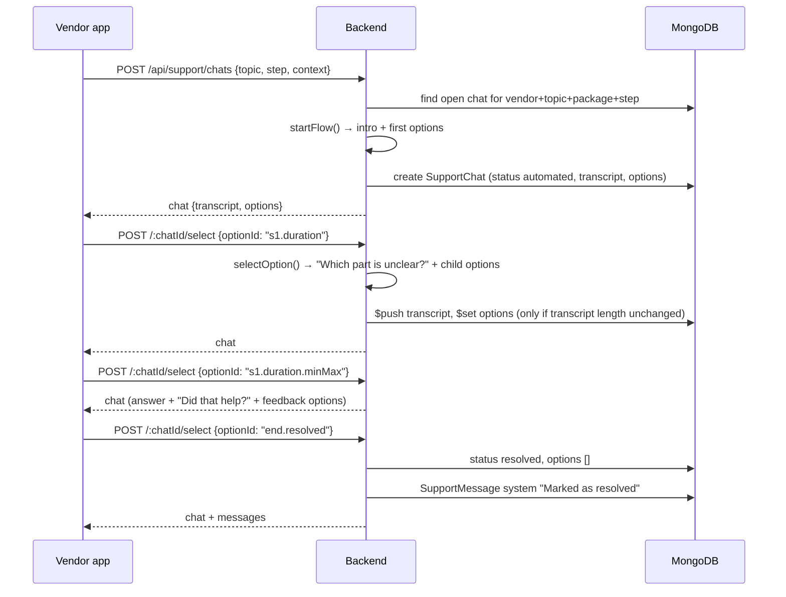
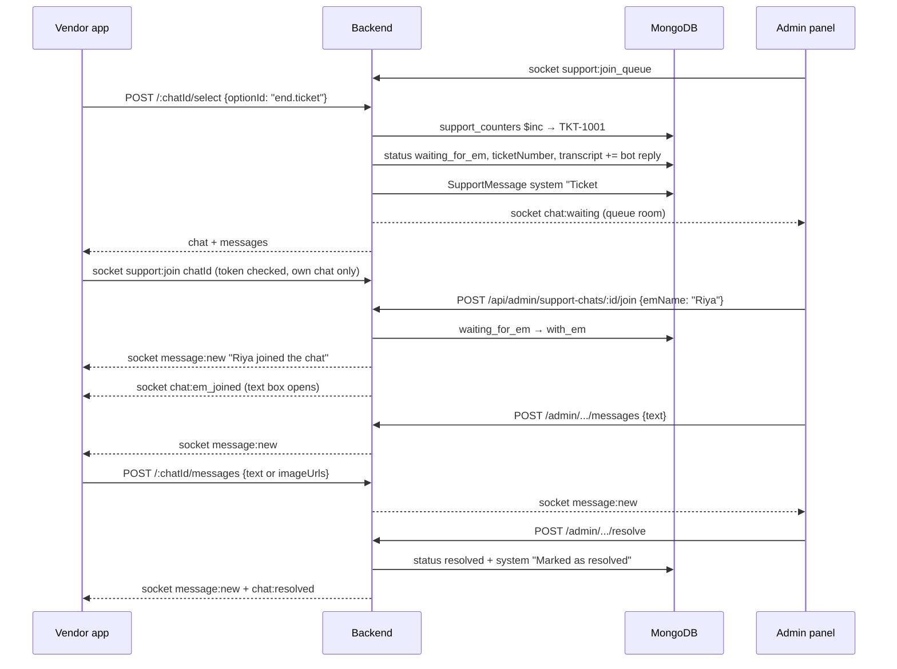

# Vendor ↔ Event Manager Support Chat — Backend Guide

This document explains the whole support chat system in the backend: what it does, which files are involved, how data is stored, every API route, the socket (live) layer, and how a chat moves from the first "Help" tap to "Resolved". Code is quoted from the repo so you can follow along.

---

## 1. What the system is

A vendor using the vendor app can tap **Help** in three places:

| Where in the app | Chat `topic` | What the bot talks about |
|---|---|---|
| A Package Setup step (steps 1–4) | `package_setup` | Questions about that step (naming, event types, duration, setups…) |
| The publish screen (step 6) | `publish_package` | What happens after "Send For Verification", tracking, changes |
| Booking Details | `booking` | Questions for that booking's stage (new request, confirmed, event day, cancelled…) |

Every chat has two parts:

1. **Automated part (the bot).** The vendor taps quick-reply buttons. The **server** decides the bot's answer and the next buttons. Everything is saved.
2. **Human part.** If the bot doesn't solve it, the vendor taps **"Something else"**. That opens a ticket (`TKT-1001`), and an Event Manager (EM) joins from the **admin panel** and chats with the vendor in free text, including photos.

The vendor can also tap **"Not quite, call me"** (an EM calls them), or **"Yes, that helps"** / **"End Chat"** (the chat closes).

This is **not** the customer help desk. It does not use Slack. It is separate from the anonymous customer chatbot (`customerChatController.js`, `chat:` rooms).

---

## 2. Big picture

```
 Vendor app (Flutter)                         Backend (Express + MongoDB + socket.io)                Admin panel (EM)
 ─────────────────────                        ───────────────────────────────────────               ─────────────────
 Tap Help ───────── POST /api/support/chats ─► openSupportChat ──► SupportChat (support_chats)
                                              │  startFlow() builds intro + first options
 ◄──────────────── { chat: transcript, options }

 Tap an option ──── POST /:chatId/select ────► selectSupportOption
                                              │  selectOption() → bot answer + next options
                                              │  saves to transcript / options / status
 ◄──────────────── { chat, messages }

 "Something else" ─ POST /:chatId/select ────► status = waiting_for_em, ticket TKT-1001
                                              │  system message "Ticket #TKT-1001 opened"
                                              └─ socket: "chat:waiting" ───────────────────────────► queue room (all EMs)

                                                                       POST /api/admin/support-chats/:id/join ◄── EM joins
 ◄── socket "message:new" ("Riya joined") ◄── joinSupportChat ◄────────┘
 ◄── socket "chat:em_joined" (text box opens)

 Type / photo ───── POST /:chatId/messages ──► sendVendorSupportMessage ── socket "message:new" ──► EM
 ◄── socket "message:new" ◄─────────────────── sendEmSupportMessage ◄── POST /admin/.../messages ◄── EM types

                                                                       POST /api/admin/support-chats/:id/resolve ◄── EM closes
 ◄── socket "chat:resolved" ◄───────────────── resolveSupportChatByEm
```

**Key idea:** sending always goes through **HTTP**. Receiving the other side's messages happens **live over socket.io**.

---

## 3. Files

### 3.1 Backend files (all under `Eventory_V2_backend/`)

| File | Role |
|---|---|
| `src/models/SupportChat.js` | Mongoose model for one chat (`support_chats` collection) |
| `src/models/SupportMessage.js` | Mongoose model for one message (`support_messages` collection) |
| `src/services/supportChatService.js` | Shared helpers: ids, ticket counter, serializers, `addMessage`, `listMessages`, socket emit helpers, room names |
| `src/services/supportFlows/supportFlowEngine.js` | **The bot.** `startFlow()` and `selectOption()` decide what the bot says and which options come next |
| `src/services/supportFlows/helpTopics.js` | Small builders `answer()`, `branch()`, `helpFlow()`, plus `findTopic()` |
| `src/services/supportFlows/packageHelpFlows.js` | Bot scripts for Package Setup steps 1–4 (step 2 setups are Decorator-only) |
| `src/services/supportFlows/publishHelpFlows.js` | Bot scripts for the publish screen (Decorator vs other vendor types) |
| `src/services/supportFlows/bookingHelpFlows.js` | Bot scripts for bookings, one set per booking stage, filled in with the booking's facts |
| `src/controllers/supportChatController.js` | Vendor routes: open, select, read messages, send message |
| `src/controllers/adminSupportChatController.js` | EM routes: list, read one, join, reply, resolve |
| `src/routes/supportChatRoutes.js` | Mounts vendor routes, forces a vendor token |
| `src/routes/adminSupportChatRoutes.js` | Mounts EM routes |
| `src/routes/index.js` | Registers both routers (`/support/chats`, `/admin/support-chats`) |
| `src/validators/supportChatValidators.js` | zod schemas for every request body / query |
| `src/config/socket.js` | `registerSupportChat()` — socket join/leave rules |
| `src/middlewares/vendorAuth.js` | `requireVendor()` for HTTP and `vendorIdFromToken()` for sockets |
| `server.js` | Creates the socket.io server and does `app.set("io", io)` so controllers can emit |

### 3.2 How the files call each other

```
server.js
 ├─ initSocket(httpServer)            src/config/socket.js
 │    └─ registerSupportChat(socket)  → SupportChat.exists(), chatRoom(), QUEUE_ROOM
 └─ app.set("io", io)                 → used by supportChatService.emitToChat / emitToQueue

src/routes/index.js
 ├─ /api/support/chats        → supportChatRoutes.js
 │     requireVendor() + validateRequest(zod) → supportChatController.js
 │                                               ├─ supportFlows/supportFlowEngine.js
 │                                               │     ├─ packageHelpFlows.js ─┐
 │                                               │     ├─ publishHelpFlows.js ─┼─ helpTopics.js
 │                                               │     └─ bookingHelpFlows.js ─┘
 │                                               ├─ supportChatService.js → SupportMessage
 │                                               └─ models: SupportChat, Package, Booking
 └─ /api/admin/support-chats  → adminSupportChatRoutes.js
       validateRequest(zod) → adminSupportChatController.js
                               ├─ supportChatService.js
                               └─ models: SupportChat, Vendor, Package, Booking
```

---

## 4. How a chat moves (status)

```
                 ┌── "Yes, that helps" / "End Chat" ─────────────────────────────► resolved
                 │
  automated ─────┼── "Not quite, call me" ─► call_requested ── EM calls, resolves ─► resolved
  (bot running)  │
                 └── "Something else" ─► waiting_for_em ── EM joins ─► with_em ── EM resolves ─► resolved
                                         (ticket TKT-…)                (free chat)
```

| Status | Meaning | Who changes it |
|---|---|---|
| `automated` | The server is running the quick replies | created by `openSupportChat` |
| `call_requested` | Vendor asked for a phone call | vendor via `select` (`end.callMe`) |
| `waiting_for_em` | Ticket open, waiting for an EM | vendor via `select` (`end.ticket`) |
| `with_em` | An EM joined; both can type | EM via `join` |
| `resolved` | Closed | vendor via `select` (`end.resolved`, `end.endChat`) or EM via `resolve` |

Every status change is done with a **conditional update** (`findOneAndUpdate` with the expected current status in the filter). If two requests race, only one wins; the other gets `409`.

---

## 5. Database

Three collections:

```
support_chats   1 ─── many   support_messages     (joined by chatId)
support_chats   0..1 ticketNumber  ◄── issued from ── support_counters  { _id: "ticket", seq }
```

### 5.1 `support_chats` (`src/models/SupportChat.js`)

```js
const TranscriptLineSchema = new mongoose.Schema(
  {
    from: { type: String, enum: ["bot", "vendor"], required: true },
    text: { type: String, required: true },
    at: { type: Date, required: true },
  },
  { _id: false }
);

const ReplyOptionSchema = new mongoose.Schema(
  {
    id: { type: String, required: true },
    label: { type: String, required: true },
  },
  { _id: false }
);

const SupportChatSchema = new mongoose.Schema(
  {
    chatId: { type: String, unique: true, required: true },
    vendorId: { type: String, required: true },
    topic: { type: String, enum: SUPPORT_CHAT_TOPICS, default: "package_setup" },
    packageId: { type: String, default: null },
    step: { type: Number, default: null },
    bookingId: { type: String, default: null },

    status: { type: String, enum: SUPPORT_CHAT_STATUSES, default: "automated" },
    ticketNumber: { type: String, default: undefined },

    emId: { type: String, default: null },
    emName: { type: String, default: null },

    context: { type: mongoose.Schema.Types.Mixed, default: {} },
    transcript: { type: [TranscriptLineSchema], default: [] },
    options: { type: [ReplyOptionSchema], default: [] },

    handedOverAt: { type: Date, default: null },
    callRequestedAt: { type: Date, default: null },
    resolvedAt: { type: Date, default: null },
    resolvedBy: { type: String, default: null },
  },
  { timestamps: true, collection: "support_chats" }
);
```

| Field | What it holds |
|---|---|
| `chatId` | Public id, e.g. `SC20261111143012123-a1b2c3`: `SC` + IST date-time to the millisecond + a random suffix (`newChatId()`) |
| `vendorId` | Owner, taken from the vendor's login token — never from the request body |
| `topic` / `packageId` / `step` / `bookingId` | Where Help was opened. Together they find "the vendor's open chat for this place" |
| `status` | See section 4 |
| `ticketNumber` | `TKT-1001`… only after "Something else" |
| `emId` / `emName` | The EM who joined |
| `context` | What the app showed on screen when Help was opened (package name, step name, variant, booking facts). The bot's intro and booking answers are built from it |
| `transcript` | The automated conversation, line by line, saved as it happens |
| `options` | The quick replies the vendor can tap **right now**. Empty once the bot is done |
| `handedOverAt`, `callRequestedAt`, `resolvedAt`, `resolvedBy` | When / by whom the status changed |

Indexes:

```js
SupportChatSchema.index({ vendorId: 1, topic: 1, packageId: 1, step: 1, bookingId: 1, status: 1 }); // "my open chat here"
SupportChatSchema.index({ status: 1, updatedAt: -1 });                                             // admin list
SupportChatSchema.index({ ticketNumber: 1 }, { unique: true, sparse: true });                      // one ticket per number
```

**Example document** (a package step chat after two taps):

```json
{
  "chatId": "SC20261111143012123-a1b2c3",
  "vendorId": "VEN123",
  "topic": "package_setup",
  "packageId": "6730…",
  "step": 1,
  "bookingId": null,
  "status": "automated",
  "context": {
    "packageName": "Royal Pastel",
    "vendorType": "Decorator",
    "totalSteps": 4,
    "stepName": "Package basics"
  },
  "transcript": [
    { "from": "bot", "text": "Hi! You're on Step 1 of 4, Package basics, for “Royal Pastel”. This is where you name the package and set events, duration and team.", "at": "…" },
    { "from": "bot", "text": "What do you need help with?", "at": "…" },
    { "from": "vendor", "text": "Event duration", "at": "…" },
    { "from": "bot", "text": "Which part is unclear?", "at": "…" }
  ],
  "options": [
    { "id": "s1.duration.minMax", "label": "Min vs max duration" },
    { "id": "s1.duration.setup", "label": "Does it include setup time?" }
  ]
}
```

**Example `context` for a booking chat** (all display strings, already formatted by the app):

```json
{
  "booking": {
    "bookingRef": "#VND-2024-00892",
    "stage": "takePayment",
    "customerName": "Rahul Sharma",
    "eventName": "Corporate Party",
    "eventDate": "Fri, 16 Oct",
    "isFreeBooking": false,
    "cancelledByCustomer": false,
    "venue": "Grand Hyatt Ballroom",
    "setupDue": "4:00 PM",
    "eventStart": "4:00 PM",
    "eventEnd": "8:00 PM",
    "amountDue": "₹4,500",
    "onGroundContact": "Amit",
    "slot": "16 Oct, 3:00 PM – 8:00 PM"
  }
}
```

### 5.2 `support_messages` (`src/models/SupportMessage.js`)

```js
export const SUPPORT_MESSAGE_SENDERS = ["vendor", "em", "system"];
export const SUPPORT_SYSTEM_EVENTS = ["ticket_opened", "call_requested", "em_joined", "resolved"];

const SupportMessageSchema = new mongoose.Schema(
  {
    messageId: { type: String, unique: true, required: true },
    chatId: { type: String, required: true },
    sender: { type: String, enum: SUPPORT_MESSAGE_SENDERS, required: true },
    senderId: { type: String, default: null },
    senderName: { type: String, default: null },
    text: { type: String, default: "" },
    imageUrls: { type: [String], default: [] },
    event: { type: String, enum: SUPPORT_SYSTEM_EVENTS, default: null },
  },
  { timestamps: { createdAt: true, updatedAt: false }, collection: "support_messages" }
);

SupportMessageSchema.index({ chatId: 1, createdAt: 1 });
```

What goes here:

| Kind | `sender` | `event` | Example `text` |
|---|---|---|---|
| Ticket opened | `system` | `ticket_opened` | `Ticket #TKT-1001 opened` |
| Call requested | `system` | `call_requested` | `Support will call you` |
| EM joined | `system` | `em_joined` | `Riya joined the chat` |
| Closed | `system` | `resolved` | `Marked as resolved` |
| Vendor message | `vendor` | `null` | text and/or up to 4 `imageUrls` |
| EM message | `em` | `null` | text and/or up to 4 `imageUrls` |

So: **the bot conversation lives in `support_chats.transcript`**, and **system lines + the human conversation live in `support_messages`**. The app shows the transcript first, then the messages in time order.

Photos are not stored in MongoDB. The app uploads them to S3 through the upload service (folder `support-chat`) and sends only the `https://` URLs.

### 5.3 `support_counters` (ticket numbers)

```js
export async function nextTicketNumber() {
  const doc = await mongoose.connection
    .collection("support_counters")
    .findOneAndUpdate({ _id: "ticket" }, { $inc: { seq: 1 } }, { upsert: true, returnDocument: "after" });
  return `TKT-${1000 + (doc?.seq ?? doc?.value?.seq ?? 0)}`;
}
```

`$inc` in one database step means two tickets opened at the same moment never get the same number. The first ticket is `TKT-1001`.

---

## 6. The bot (flow engine)

### 6.1 How a script is written

Scripts are plain data built with three helpers (`helpTopics.js`):

```js
export const answer = (id, label, text) => ({ id, label, answer: text, children: [] });
export const branch = (id, label, prompt, children) => ({ id, label, prompt, children });
export const helpFlow = ({ fallbackSummary, topics, offersEndChat = false }) => ({ fallbackSummary, topics, offersEndChat });
```

- **`answer`** — a button that, when tapped, gives a final answer, then "Did that help?".
- **`branch`** — a button that asks a follow-up question and shows more buttons (its `children`).
- **`helpFlow`** — one whole script: an intro sentence (`fallbackSummary`), the first buttons (`topics`), and whether "End Chat" is offered (only booking chats).

Example from `packageHelpFlows.js` (shortened):

```js
const step1 = helpFlow({
  fallbackSummary: "This is where you name the package and set events, duration and team.",
  topics: [
    answer("s1.name", "How should I name my package?",
      "Lead with style, setup and occasion, like “Pastel Floral Mandap for Weddings”. Keep it under 50 characters."),
    branch("s1.duration", "Event duration", "Which part is unclear?", [
      answer("s1.duration.minMax", "Min vs max duration",
        "Min is the shortest booking you'll accept and Max is the longest. Customers pick hours between the two."),
      answer("s1.duration.setup", "Does it include setup time?",
        "No. Duration is the hours your team stays at the event. Setup time goes under Team and Setup."),
    ]),
  ],
});
```

Which script is used:

| Topic | Function | Chosen by |
|---|---|---|
| `package_setup` | `packageHelpFlowFor({ step, vendorType })` | `chat.step`; step 2 is different for `Decorator` |
| `publish_package` | `publishHelpFlowFor({ vendorType })` | Decorator vs everyone else |
| `booking` | `bookingHelpFlowFor(chat.context.booking)` | `booking.stage` (10 stages); text is filled with the booking's facts; some topics only appear when they apply (e.g. "What is a Free booking?" only for free bookings, "I cancelled by mistake" only when the vendor cancelled) |

### 6.2 The engine (`supportFlowEngine.js`)

Fixed option ids that every script shares:

```js
export const OPTION_IDS = {
  resolved: "end.resolved",       // "Yes, that helps"
  callMe: "end.callMe",           // "Not quite, call me"
  somethingElse: "end.somethingElse", // "Help with something else" → back to the first buttons
  ticket: "end.ticket",           // "Something else" → ticket
  endChat: "end.endChat",         // "End Chat" (booking only)
};

export const OUTCOMES = { continue: "continue", resolved: "resolved", callRequested: "call_requested", ticket: "ticket" };
```

**`startFlow(chat)`** — called when a chat opens. Returns the first two bot lines and the first buttons:

```js
export const startFlow = (chat) => {
  const flow = flowFor(chat);
  return { lines: bot(introOf(chat, flow), WHAT_DO_YOU_NEED), options: rootOptions(flow) };
};
```

The intro depends on the topic:

```js
switch (chat.topic) {
  case "booking":         return "Hi!";   // + the booking's stage intro (fallbackSummary)
  case "publish_package": return `Hi! You're about to publish ${name ? `“${name}”` : "your package"} (${context.variantName} variant).`;
  default:                return `Hi! You're on Step ${chat.step} of ${context.totalSteps}, ${context.stepName}${name ? `, for “${name}”` : ""}.`;
}
```

The first buttons are the script's topics, then **"Something else"**, then **"End Chat"** if the script offers it:

```js
const rootOptions = (flow) => [
  ...flow.topics.map(optionOf),
  { id: OPTION_IDS.ticket, label: SOMETHING_ELSE_LABEL },
  ...(flow.offersEndChat ? [END_CHAT] : []),
];
```

**`selectOption(chat, optionId, { ticketNumber })`** — called on every tap. It only accepts an option that is in `chat.options` right now, and only while `status === "automated"`; otherwise it returns `null`. It returns `{ outcome, lines, options }`:

| Tapped | `outcome` | Lines added to the transcript | Next `options` |
|---|---|---|---|
| A `branch` topic | `continue` | vendor label, bot follow-up question | the branch's children (+ End Chat) |
| An `answer` topic | `continue` | vendor label, bot answer, "Did that help?" | Yes, that helps · Not quite, call me · Help with something else |
| `end.somethingElse` | `continue` | vendor label, "Sure. Here's everything I can help with here.", "What else do you need help with?" | the first buttons again |
| `end.resolved` | `resolved` | vendor label, "Great, glad that helped. You can reopen this chat any time from Help & Support." | none |
| `end.endChat` | `resolved` | vendor label | none |
| `end.callMe` | `call_requested` | vendor label, "No problem. A support specialist will call you in the next 10 minutes." | none |
| `end.ticket` | `ticket` | vendor label, "I've opened ticket #TKT-1001 for you. A support specialist will reply in this chat within 2 hours." | none |

The engine is **pure**: it does not touch the database. The controller saves what it returns.

---

## 7. Vendor API (`/api/support/chats`)

All vendor routes run behind this guard in `supportChatRoutes.js`:

```js
const requireVendorIdentity = [
  requireVendor(),
  (req, res, next) =>
    req.authVendorId
      ? next()
      : res.status(401).json({ success: false, status: "FAILED", message: "Authentication required. Please log in again." }),
];

router.use(requireVendorIdentity);

router.post("/", validateRequest(openSupportChatSchema), openSupportChat);
router.post("/:chatId/select", validateRequest(selectSupportOptionSchema), selectSupportOption);
router.get("/:chatId/messages", getSupportChatMessages);
router.post("/:chatId/messages", validateRequest(vendorSupportMessageSchema), sendVendorSupportMessage);
```

`requireVendor()` reads `Authorization: Bearer <vendor JWT>` and sets `req.authVendorId`. Elsewhere in the API `VENDOR_AUTH_MODE=report` only logs missing tokens, but here the second function **always** refuses a request without a vendor, because chats contain vendor contact and business details.

`validateRequest(schema)` runs the zod schema before the controller, replaces `req.body` with the parsed value (defaults applied, unknown keys removed) and returns `400 { message: "Validation failed", errors: [...] }` on bad input.

Every chat lookup includes the vendor:

```js
const ownChat = async (req, res) => {
  const chat = await SupportChat.findOne({ chatId: req.params.chatId, vendorId: req.authVendorId });
  if (!chat) fail(res, 404, "Chat not found");
  return chat;
};
```

So a vendor can never see or change another vendor's chat (they get `404`).

### 7.1 `POST /api/support/chats` — open Help

**Body** (`openSupportChatSchema`):

```js
{
  topic: "package_setup" | "publish_package" | "booking",   // default package_setup
  packageId?: string,
  step?: 1..20,                 // required for package_setup
  bookingId?: string,           // required for booking
  context: {
    vendorType?, packageName = "", totalSteps?, stepName?, variantName?,
    booking?: { bookingRef, stage, customerName, eventName, eventDate,
                isFreeBooking, cancelledByCustomer, timeLeftToRespond?, expiresAt?,
                venue?, setupDue?, eventStart?, eventEnd?, amountDue?, onGroundContact?, slot? }
  }
}
```

Rules enforced by the schema: `package_setup` needs `step`; `booking` needs `bookingId` **and** `context.booking`. Every text field is trimmed and limited to 200 characters. `stage` must be one of the 10 booking stages.

**What the controller does:**

```js
// 1. Ownership: the package / booking must belong to the calling vendor
if (packageId && !(await packageBelongsTo(packageId, vendorId))) return fail(res, 403, "…");
if (bookingId && !(await bookingBelongsTo(bookingId, vendorId))) return fail(res, 403, "…");

// 2. Find the vendor's unresolved chat for this exact place
const found = await SupportChat.findOne({ vendorId, topic, packageId, step, bookingId, status: { $ne: "resolved" } })
  .sort({ createdAt: -1 });

// 3a. Ticket / call / EM chat in progress → return it as is, with its messages
if (found && found.status !== "automated") {
  return res.json({ success: true, data: { chat: serializeChat(found), messages: await listMessages(found.chatId) } });
}

// 3b. Otherwise start the bot from the top (new chat, or restart an automated one)
const now = new Date();
const fields = { topic, packageId, step, bookingId, context };
const chat = found
  ? await SupportChat.findOneAndUpdate(
      { _id: found._id, status: "automated" },
      { $set: { context, ...freshFlow(fields, now) } },
      { returnDocument: "after" }
    )
  : await SupportChat.create({ chatId: newChatId(), vendorId, ...fields, ...freshFlow(fields, now) });
```

`freshFlow()` runs `startFlow()` and stamps each line with the time:

```js
const freshFlow = (chat, now) => {
  const { lines, options } = startFlow(chat);
  return { transcript: lines.map((line) => ({ ...line, at: now })), options };
};
```

Ownership checks:

- `packageBelongsTo` — a package id that isn't a valid ObjectId (a draft not saved yet) or doesn't exist is allowed; a real package must belong to the vendor.
- `bookingBelongsTo` — the booking **must** exist and belong to the vendor. Vendor ids are normalised with `resolveVendorRefId()` (bookings may store a public id or an ObjectId).

**Response:** `201` for a new chat, `200` for an existing one:

```json
{ "success": true, "data": { "chat": { "chatId": "…", "status": "automated", "transcript": [ … ], "options": [ … ], "context": { … }, … }, "messages": [] } }
```

### 7.2 `POST /api/support/chats/:chatId/select` — tap a quick reply

**Body:** `{ "optionId": "s1.duration" }`

```js
export const selectSupportOption = async (req, res) => {
  const chat = await ownChat(req, res);
  if (!chat) return;
  const { optionId } = req.body;
  if (chat.status !== "automated") return fail(res, 409, "This chat has moved on. Open Help again.");
  if (!chat.options.some((o) => o.id === optionId)) return fail(res, 409, "That reply isn't available any more");

  const ticketNumber = optionId === OPTION_IDS.ticket ? await nextTicketNumber() : null;
  const step = selectOption(chat, optionId, { ticketNumber });
  if (!step) return fail(res, 409, "That reply isn't available any more");

  const now = new Date();
  const updated = await SupportChat.findOneAndUpdate(
    { _id: chat._id, status: "automated", transcript: { $size: chat.transcript.length } },
    {
      $set: { options: step.options, ...OUTCOME_UPDATES[step.outcome](now, ticketNumber) },
      $push: { transcript: { $each: step.lines.map((line) => ({ ...line, at: now })) } },
    },
    { returnDocument: "after" }
  );
  if (!updated) return fail(res, 409, "This chat changed. Open Help again.");

  const event = OUTCOME_EVENTS[step.outcome]?.(ticketNumber);
  if (event) await addMessage(updated.chatId, { sender: "system", ...event });
  if (step.outcome === OUTCOMES.ticket) emitToQueue(req, "chat:waiting", serializeChat(updated));

  const messages = updated.status === "automated" ? [] : await listMessages(updated.chatId);
  return res.json({ success: true, data: { chat: serializeChat(updated), messages } });
};
```

How each outcome changes the chat:

```js
const OUTCOME_UPDATES = {
  continue:       () => ({}),
  resolved:       (now) => ({ status: "resolved", resolvedAt: now, resolvedBy: "vendor" }),
  call_requested: (now) => ({ status: "call_requested", callRequestedAt: now }),
  ticket:         (now, ticketNumber) => ({ status: "waiting_for_em", ticketNumber, handedOverAt: now }),
};

const OUTCOME_EVENTS = {
  resolved:       () => ({ event: "resolved", text: "Marked as resolved" }),
  call_requested: () => ({ event: "call_requested", text: "Support will call you" }),
  ticket:         (ticketNumber) => ({ event: "ticket_opened", text: `Ticket #${ticketNumber} opened` }),
};
```

**Double-tap safety:** the update only matches if the transcript still has the length the controller read (`transcript: { $size: … }`). If the vendor taps twice quickly, the second request finds the transcript already longer and gets `409`. Nothing is saved twice.

**Response:** the updated chat (with the new transcript lines and next options). `messages` is filled once the chat has left the bot stage (so the app gets "Ticket #… opened" etc.).

### 7.3 `GET /api/support/chats/:chatId/messages`

Returns `{ chat, messages }` for the vendor's own chat. The app uses it to catch up on messages missed while the socket was disconnected.

### 7.4 `POST /api/support/chats/:chatId/messages` — vendor sends a message

**Body** (`vendorSupportMessageSchema`): `{ text?: string ≤ 2000, imageUrls?: https URL[] ≤ 4 }`, at least one of them.

Only allowed while `status === "with_em"` (otherwise `409 "You can message once a support specialist joins"`). Saves a `vendor` message, bumps the chat's `updatedAt` (so it rises in the admin list), and emits `message:new` to the chat room so the EM sees it immediately.

---

## 8. Event Manager API (`/api/admin/support-chats`)

Used by the admin panel. Same access model as the other `/api/admin` routes (see Security). The EM identifies themselves with `emId` / `emName` in the body.

```js
router.get("/", validateRequest(adminSupportChatListSchema, "query"), listSupportChats);
router.get("/:chatId", getSupportChat);
router.post("/:chatId/join", validateRequest(emJoinSchema), joinSupportChat);
router.post("/:chatId/messages", validateRequest(emMessageSchema), sendEmSupportMessage);
router.post("/:chatId/resolve", validateRequest(emResolveSchema), resolveSupportChatByEm);
```

| Route | Body / query | What it does |
|---|---|---|
| `GET /` | `?status=&topic=&ticket=&emId=&page=1&limit=20` | Chats, newest activity first. Each row adds `vendor` (business name, contact name, phone), `package` (name, type) and `booking` (number, status, event, date, customer). The transcript is left out of the list to keep it small |
| `GET /:chatId` | — | One chat with vendor, package, booking, the full transcript and all messages |
| `POST /:chatId/join` | `{ emId?, emName }` | Only from `waiting_for_em` → `with_em`. Saves "Riya joined the chat", emits `message:new` and `chat:em_joined`. The same EM joining again gets `200`; a different EM gets `409 "Riya has already joined this chat"` |
| `POST /:chatId/messages` | `{ emId?, emName, text?, imageUrls? }` | Only in `with_em`. Saves an `em` message and emits `message:new` |
| `POST /:chatId/resolve` | `{ emId?, emName? }` | Any open status → `resolved` (also used after making a requested call). Saves "Marked as resolved", emits `message:new` and `chat:resolved`. Resolving twice is harmless |

Join is a conditional update, so two EMs clicking Join together can't both join:

```js
const updated = await SupportChat.findOneAndUpdate(
  { _id: chat._id, status: "waiting_for_em" },
  { $set: { status: "with_em", emId, emName } },
  { returnDocument: "after" }
);
```

---

## 9. Live updates (socket.io)

socket.io is created in `server.js` and stored on the Express app so controllers can reach it:

```js
const io = initSocket(httpServer);
app.set("io", io);
```

### 9.1 Rooms

```js
export const chatRoom = (chatId) => `support:${chatId}`;  // one room per chat
export const QUEUE_ROOM = "support:queue";               // every EM in the admin panel
```

| Room | Who is in it | Events pushed into it |
|---|---|---|
| `support:<chatId>` | the vendor who owns the chat + any EM viewing it | `message:new`, `chat:em_joined`, `chat:resolved` |
| `support:queue` | every EM with the admin panel open | `chat:waiting` (a new ticket needs an EM) |

Controllers push with two helpers:

```js
const io = (req) => req.app.get("io");
export function emitToChat(req, chatId, event, payload) { io(req)?.to(chatRoom(chatId)).emit(event, payload); }
export function emitToQueue(req, event, payload) { io(req)?.to(QUEUE_ROOM).emit(event, payload); }
```

### 9.2 Connecting and joining (`src/config/socket.js`)

```js
function registerSupportChat(socket) {
  const auth = socket.handshake.auth ?? {};
  const vendorId = typeof auth.token === "string" ? vendorIdFromToken(auth.token) : null;
  const isEm = auth.role === "em";

  socket.on("support:join", async (chatId, ack) => {
    const id = chatId.trim();
    if (!isEm) {
      if (!vendorId) return reply(ack, { ok: false, error: "Authentication required" });
      if (!(await SupportChat.exists({ chatId: id, vendorId }))) return reply(ack, { ok: false, error: "Chat not found" });
    }
    socket.join(chatRoom(id));
    return reply(ack, { ok: true });
  });

  socket.on("support:leave", (chatId) => socket.leave(chatRoom(chatId.trim())));

  socket.on("support:join_queue", (ack) => {
    if (!isEm) return reply(ack, { ok: false, error: "Not allowed" });
    socket.join(QUEUE_ROOM);
    return reply(ack, { ok: true });
  });
}
```

- **Vendor app** connects with `auth: { token: "<vendor JWT>" }`. `vendorIdFromToken()` checks the token the same way the HTTP middleware does. The vendor can only join a room for a chat they own.
- **Admin panel** connects with `auth: { role: "em" }` and can join any chat room and the queue.

Client events:

| Emit | Payload | Answer (ack) |
|---|---|---|
| `support:join` | `chatId` | `{ ok: true }` or `{ ok: false, error }` |
| `support:leave` | `chatId` | — |
| `support:join_queue` | — | `{ ok: true }` or `{ ok: false, error }` (EM only) |

Server events:

| Event | Payload | Sent when |
|---|---|---|
| `message:new` | a serialized message (`messageId, chatId, sender, senderName, text, imageUrls, event, createdAt`) | vendor or EM sends, EM joins, EM resolves |
| `chat:em_joined` | `{ chatId, emId, emName }` | EM joins → the vendor's text box opens |
| `chat:resolved` | `{ chatId }` | EM resolves |
| `chat:waiting` | a serialized chat | vendor opened a ticket (queue room) |

A sender also receives their own `message:new` echo. The vendor app ignores vendor echoes because it already shows the message it sent.

**Example (admin panel, JavaScript):**

```js
const socket = io(BACKEND_ORIGIN, { transports: ["websocket"], auth: { role: "em" } });
socket.emit("support:join_queue", (res) => console.log(res));       // { ok: true }
socket.on("chat:waiting", (chat) => addToList(chat));
socket.emit("support:join", chatId, (res) => console.log(res));
socket.on("message:new", (m) => appendMessage(m));
```

**Example (vendor app, Dart — `RemoteSupportChatRepository.live`):**

```dart
final s = io.io(origin, io.OptionBuilder()
    .setTransports(['websocket'])
    .setAuth({'token': token})
    .disableAutoConnect()
    .enableForceNew()
    .build());
s.onConnect((_) => s.emit('support:join', chatId));   // on reconnect it also reloads GET /messages
s.on('message:new', (data) => …);
s.on('chat:em_joined', (data) => …);
s.on('chat:resolved', (_) => …);
s.connect();
```

---

## 10. Complete chat flows

### 10.1 Bot solves it



### 10.2 Ticket → EM chat → resolved



### 10.3 Call request

1. Vendor taps an answer, then **"Not quite, call me"** → `select` with `end.callMe`.
2. Chat becomes `call_requested`, system message "Support will call you".
3. The admin panel lists it (`GET /api/admin/support-chats?status=call_requested`).
4. EM calls the vendor, then `POST /:chatId/resolve`.

### 10.4 Reopening Help

| Chat state when Help is tapped again | What `open` returns |
|---|---|
| `automated` | The same chat, with the bot **restarted from the top** (fresh transcript and options, updated context) |
| `call_requested`, `waiting_for_em`, `with_em` | The same chat unchanged, plus all its messages; the app reconnects to the socket |
| `resolved` | A **new** chat |

---

## 11. What the app does with the responses

The app no longer has any bot logic. In `lib/features/support_chat/`:

- `data/repositories/remote_support_chat_repository.dart` — calls `open` (sending `context`), `select`, `messages`, uploads photos, and listens on the socket.
- `data/support_thread_builder.dart` — turns the server's `chat` + `messages` into what the screen shows: consecutive bot lines become one bubble group, system messages become dividers, `options` become the buttons, `status` decides the footer.
- `presentation/cubit/support_chat_cubit.dart` — on a tap it shows the vendor's choice straight away and shows typing dots while waiting for `select`. If the request fails, it puts the previous buttons back.
- `presentation/widgets/support_conversation.dart` — plays the reply in: vendor bubble, typing dots, bot answer, then the buttons.
- Booking facts (stage, times, amount due…) are worked out in the app (`booking_and_inquiry/presentation/models/booking_support_context.dart`) and sent in `context.booking`.

---

## 12. How to change the bot

**Change wording:** edit the text in `packageHelpFlows.js`, `publishHelpFlows.js` or `bookingHelpFlows.js` and deploy the backend. No app release is needed.

**Add a question to a step:**

```js
// packageHelpFlows.js, inside step1's topics
answer("s1.photos", "Can I add photos here?", "Photos are added in Step 4, Photos & Videos."),
```

Ids must be unique inside a script and must not start with `end.` (reserved for the fixed options).

**Add a follow-up question:**

```js
branch("s1.travel", "Travel and outstation events", "What about travel?", [
  answer("s1.travel.charges", "Can I charge for travel?", "…"),
  answer("s1.travel.cities", "Which cities can I serve?", "…"),
]),
```

**Add a new topic** (a new place in the app with Help):

1. Add the topic to `SUPPORT_CHAT_TOPICS` in `SupportChat.js`.
2. Write `xyzHelpFlowFor(...)` in a new file under `supportFlows/`.
3. Add a `case` for it in `flowFor()` and `introOf()` in `supportFlowEngine.js`.
4. If it needs extra context, add the fields to `chatContext` in `supportChatValidators.js`.

Changes only affect chats opened **after** the deploy. A chat in progress keeps the options it already has, because `options` are stored on the chat.

---

## 13. Safety and rules

| Concern | How it's handled |
|---|---|
| A vendor reading another vendor's chat | Every vendor query includes `vendorId: req.authVendorId`; the socket checks the same before joining a room |
| Opening Help on someone else's package/booking | `packageBelongsTo` / `bookingBelongsTo` → `403` |
| Requests without a vendor token | `401` on every vendor route, whatever `VENDOR_AUTH_MODE` says |
| Tapping an option that isn't on screen | `409 "That reply isn't available any more"` |
| Double taps / two devices | conditional update on transcript length → second request `409` |
| Two EMs joining at once | conditional update on `status: "waiting_for_em"` → second EM `409` |
| Same ticket number twice | `$inc` counter + unique sparse index on `ticketNumber` |
| Oversized or extra input | zod: lengths capped, unknown keys stripped, images must be `https://`, max 4 |
| EM routes | **Same as the rest of `/api/admin` today: no login.** Anyone who can reach `/api/admin/*` can read and reply to chats, and the EM socket only checks `role: "em"`. Securing this belongs with the admin panel login work |

Error responses all look like `{ "success": false, "message": "…" }`:

| Code | When |
|---|---|
| `400` | validation failed (with `errors: [{ field, message }]`) |
| `401` | no or invalid vendor token |
| `403` | package or booking isn't the vendor's |
| `404` | chat not found (or not the vendor's) |
| `409` | wrong status for the action, option not on offer, or a race lost |
| `500` | unexpected error (logged with the handler name) |

---

## 14. Testing

There is no test runner in this repo. The system was checked with a script that starts an in-memory MongoDB (`mongodb-memory-server`) and calls the controllers directly. It covers: opening a chat, branches and answers, "Help with something else", reopening (restart vs keep), another vendor being refused, ticket opening with the queue event, no quick replies after handover, call request, a booking chat with End Chat, someone else's booking being refused, and a double tap only counting once.

The bot scripts were also checked against the previous Dart versions: 151 inputs (every package step × vendor type, every publish vendor type, every booking stage with filled and missing facts) produced identical output.

---

## 15. Known limits

- Every tap needs the network. With no connection the app shows an error and keeps the buttons.
- Booking facts are formatted in the app and trusted as display text (they only appear in that vendor's own chat and to EMs).
- If saving the system message fails after the status changed, the request returns `500` but the status change stays. The chat is still usable; only that divider line is missing.
- "Help tapped again → Reopened / Welcome back!" from the design is not built.
- The admin panel must show `imageUrls` and the `booking` info; that's admin panel work.
